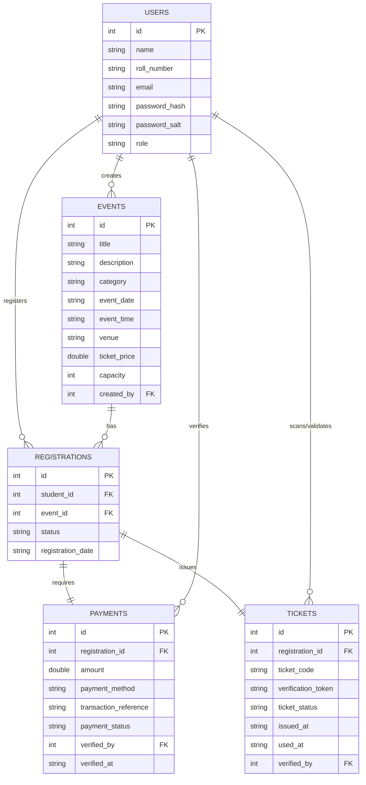
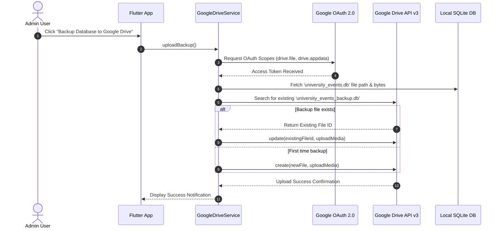

# 🎓 University Event Management System (`university_event_system`)

A modern, cross-platform **University Event Management System** built with **Flutter**, featuring SQLite local database storage, role-based access control (Admin, Student, Guard), digital QR ticket generation and scanning, and seamless **Google Cloud Drive Backup & Restore**.

---

## 📚 Table of Contents
1. [Key Features](#-1-key-features)
2. [User Roles & Pre-Seeded Logins](#-2-user-roles--pre-seeded-logins)
3. [SQLite Database Architecture & Schema](#-3-sqlite-database-architecture--schema)
4. [Google Cloud Drive Backup & Restore System](#-4-google-cloud-drive-backup--restore-system)
5. [Setup & Google Cloud Console Configuration Guide](#-5-setup--google-cloud-console-configuration-guide)
6. [Project Folder Structure](#-6-project-folder-structure)

---

## ⚡ 1. Key Features

* **Multi-Platform Support:** Works on Android, iOS, Windows, macOS, and Linux.
* **Role-Based Workflows:**
  * **Admin:** Event CRUD, Payment verification, Ticket issuance, Gate entry analytics, Guard account creation, Google Cloud Backup.
  * **Student:** Event browsing, Registration, Manual Payment Reference submission (TID), Digital QR Ticket access.
  * **Security Guard:** Mobile QR scanner & Roll Number gate validation, Real-time entry log verification (`Valid`, `Used`, `Invalid`).
* **Offline First & High Performance:** Built on SQLite (`sqflite` / `sqflite_common_ffi`) with atomic database transactions.
* **Cryptographic Security:** Passwords hashed with SHA-256 and dynamic dynamic salts.
* **Google Cloud Backup:** Full database backup to Google Drive & instant restoration.

---

## 👥 2. User Roles & Pre-Seeded Logins

The database initializes with demo credentials for instant testing:

| Role | Name | Email | Password | Identifier / Roll No | Duties & Access |
| :--- | :--- | :--- | :--- | :--- | :--- |
| **Admin** | System Administrator | `abdullah123@gmail.com` *(or `admin@university.edu`)* | `admin123` | N/A | Full Administrative control, Event CRUD, Payment Approvals, Cloud Backups |
| **Student** | Fiaz Ahmad | `fiaz1983@gmail.com` | `Fiaz1983` | `FA24-BSE-127` | Browse events, Register, Submit payment receipts, View QR tickets |
| **Guard** | Officer Tariq | `guard@university.edu` | `guard123` | N/A | Gate entry validation, QR scanner, Roll number search, Scan history |

---

## 🗄️ 3. SQLite Database Architecture & Schema

The application utilizes a local SQLite database named **`university_events.db`**, managed through [`DatabaseHelper.dart`](file:///C:/Users/fiaza/.gemini/antigravity/scratch/university_event_system/lib/database/database_helper.dart).

### 📐 Database ERD / Schema



### 🔐 Password Hashing & Security Mechanism
* Passwords are never stored in plain text.
* On user registration or creation:
  1. A random 16-byte salt is generated via `Random.secure()`.
  2. The salt is prepended to the plain password and hashed using **SHA-256**.
  3. Both `password_hash` and `password_salt` are stored in the database.
* Verification re-calculates `sha256(stored_salt + input_password)` and performs string comparison.

---

## ☁️ 4. Google Cloud Drive Backup & Restore System

The cloud system is powered by [`google_drive_service.dart`](file:///C:/Users/fiaza/.gemini/antigravity/scratch/university_event_system/lib/services/google_drive_service.dart) using OAuth 2.0 and the official `googleapis/drive/v3.dart` library.

### ⚙️ How Google Cloud Integration Works:



### 📤 1. Cloud Backup Operation (`uploadBackup`)
1. **Authentication:** Prompts user to authenticate via Google Account using OAuth 2.0 with `drive.file` and `drive.appdata` scopes.
2. **File Access:** Locates the local SQLite file `university_events.db` from `getDatabasesPath()`.
3. **Drive Search:** Queries Google Drive API: `name = 'university_events_backup.db' and trashed = false`.
4. **Incremental Sync:**
   * If an existing backup file exists on Google Drive, it calls `driveApi.files.update` to replace its contents with the latest local database file.
   * If no backup exists, it calls `driveApi.files.create` to create `university_events_backup.db`.

### 📥 2. Cloud Restore Operation (`restoreBackup`)
1. **Search & Fetch:** Queries Google Drive for `university_events_backup.db` and requests full media download (`DownloadOptions.fullMedia`).
2. **Stream Processing:** Reads downloaded stream chunks into byte arrays.
3. **Database Lock & Release:**
   * Closes active SQLite connection: `DatabaseHelper.instance.close()`.
   * Overwrites local `university_events.db` file with downloaded cloud bytes.
   * Re-opens SQLite connection: `DatabaseHelper.instance.database`.
4. All local records instantly refresh to match the cloud state.

---

## 🛠️ 5. Setup & Google Cloud Console Configuration Guide

To enable Google Cloud Drive sync on your own Google Cloud account:

### 1️⃣ Google Cloud Project Setup
1. Go to [Google Cloud Console](https://console.cloud.google.com/).
2. Create a new project (e.g., `University Event System`).
3. Enable **Google Drive API** in *APIs & Services > Library*.

### 2️⃣ Configure OAuth Consent Screen
1. Go to *APIs & Services > OAuth consent screen*.
2. Select **External** user type.
3. Fill App Name (`Campus Events`) and User Support Email.
4. Add Scopes: `https://www.googleapis.com/auth/drive.file` and `https://www.googleapis.com/auth/drive.appdata`.
5. Add test user emails under *Test Users*.

### 3️⃣ Create Credentials (Web & Android)
1. **Web Client ID:** Create OAuth 2.0 Web Application Client ID and copy the Client ID string into `_webClientId` in `google_drive_service.dart`.
2. **Android Client ID:** Create OAuth 2.0 Android Client ID:
   * **Package Name:** `com.university.events.university_event_system`
   * **SHA-1 Fingerprint:** Obtain using `./gradlew signingReport` in `android/` directory:
     ```bash
     cd android
     ./gradlew signingReport
     ```

---

## 📂 6. Project Folder Structure

```text
university_event_system/
├── android/                      # Native Android Gradle configuration & AndroidManifest
├── ios/                          # Native iOS Xcode project
├── lib/
│   ├── database/
│   │   └── database_helper.dart  # SQLite initialization, schema creation, seeding & password hashing
│   ├── models/                   # Data models (User, Event, Registration, Payment, Ticket)
│   ├── services/                 # Business logic & DAO Layer
│   │   ├── auth_service.dart
│   │   ├── event_service.dart
│   │   ├── google_drive_service.dart  # Google Cloud Drive API v3 sync & restore
│   │   ├── payment_service.dart
│   │   ├── registration_service.dart
│   │   └── ticket_service.dart
│   ├── screens/
│   │   ├── admin/                # Admin Dashboard, Event CRUD, Payment Approval, Backup Screen
│   │   ├── auth/                 # Modern Responsive Login & Registration screens
│   │   ├── guard/                # Guard Dashboard, QR Scanner, Roll Check, Verification Result
│   │   └── student/              # Event Browsing, Registration, Payment Submission, QR Tickets
│   └── widgets/                  # Reusable UI Buttons, Event Cards, Ticket Widgets
├── pubspec.yaml                  # Project dependencies & assets
└── README.md                     # Comprehensive System Documentation
```

---

## 👨‍💻 Developer Notes & Running the App

Run the application directly on your connected Android device or Desktop:

```bash
# Get dependencies
flutter pub get

# Run on connected device (Pixel 8 / Desktop / Web)
flutter run
```
